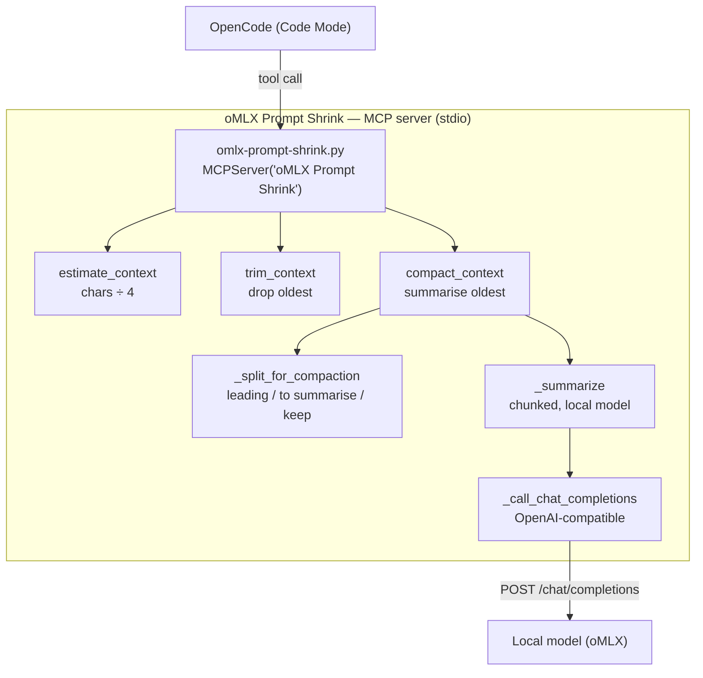

# oMLX Prompt Shrink


🌐 **English** · [Türkçe](./README.tr.md)

**oMLX Prompt Shrink** is a tiny MCP server that keeps **oMLX / local Qwen** requests under the model's context limit. It measures the context before the call, then either **drops** the oldest messages or **compacts** them into a summary — instead of letting the server reject the request.

> **Token counting:** uses `tiktoken` when it is installed (`cl100k_base` by default) for a close approximation, and falls back to a tokenizer-free estimate (character count ÷ 4) otherwise. Either way it is a guard rail, not an exact budget — set `OMLX_SHRINK_TOKENIZER` to change the behaviour.

---

## 📖 Overview

oMLX profiles for this class of models run **32K context** (`max_context_window: 32768`). That is a deliberate choice: with a 4-bit KV cache it keeps the runtime footprint at roughly 17–20 GB per model and keeps prefill short on Apple Silicon. Raising the limit is not free — every extra token of context is paid for in memory and prefill time.

The cost appears in a long session. The system prompt, the conversation history and the tool results accumulate, and once the total crosses the ceiling the server refuses the whole request:

```text
Prompt is too long: 39514 tokens > 32768 maximum context length
```

At that point the agent stops. Nothing was wrong with the question — the prompt was simply 6.7K tokens too big. The usual workarounds are all unsatisfying:

| Workaround | Why it falls short |
| :--- | :--- |
| Raise `max_context_window` | Moves the wall, does not remove it; costs memory and prefill speed on the same machine |
| Truncate by hand | Manual, easy to forget, throws away whole sessions |
| Start a new session | Loses the context that made the task work in the first place |

So this server takes the cheap path: **keep 32K, send a smaller prompt.**

Read the full walkthrough (why 32K, the three compaction modes, the environment configuration, and the known limitations):

**[English →](./README.md)** · **[Türkçe →](./README.tr.md)**

---

## ✅ Recommendation

Use it if you run oMLX or another local OpenAI-compatible server with a fixed context window and you have hit `Prompt is too long` at least once. It is a single Python file and needs no GPU. `estimate_context` and `trim_context` are pure arithmetic — they cost nothing at inference time. `compact_context` only calls the local model when you ask it to summarise (or you can hand it a summary yourself and it calls nothing at all).

You probably do not need it if your context window is large enough for your sessions, or if your client already compacts history on its own.

---

## 🛠️ Tech Stack & Architecture

- **Language & Runtime:** Python 3.10+, standard library only
- **Protocol:** Model Context Protocol (MCP) over stdio transport
- **Client:** OpenCode (Code Mode groups tools under `tools.oMLX_Prompt_Shrink.*`)
- **Compaction Engine:** Chunked summarisation via the local OpenAI-compatible endpoint
- **Token Counting:** optional `tiktoken` (default `cl100k_base`) with a character heuristic fallback — no hard dependency
- **Dependencies:** `mcp` (MCP SDK) required; `tiktoken` optional — no GPU
- **Target Server:** oMLX (or any local OpenAI-compatible server: llama.cpp, LM Studio, …)
- **Defaults:** `max_context_tokens = 32768`, `keep_last = 8`, `threshold = 0.8`

---

## ✨ Features

- 🧮 **Accurate-enough estimate** — `estimate_context` returns the estimated token count, the remaining budget and a `should_trim` flag
- ✂️ **Drop oldest messages** — `trim_context` returns the message list with the oldest messages removed, keeping the most recent `keep_last`
- 🧠 **Compact instead of drop** — `compact_context` replaces the oldest messages with a **summary**, keeping leading system messages and the most recent `keep_last` verbatim
- 📝 **Three compaction modes** — summary provided, model-generated, or plan-only (`needs_summary: true`, no message content echoed back)
- 🌐 **Optional real tokenizer** — uses `tiktoken` when installed, otherwise a tokenizer-free estimate (chars ÷ 4); `OMLX_SHRINK_TOKENIZER` controls the choice
- 🔌 **Plain MCP** — any MCP client can use the server, not just OpenCode
- 🧩 **Chunked summarisation** — long histories are summarised in pieces so the local model does not overflow while summarising
- 🔒 **No telemetry, no network calls** except the optional local summariser request

---

## 📸 Screenshots

_(No UI — this is a headless MCP server. Tool output is JSON on stdio.)_

---

## 🏗️ Architecture




---

### `compact_context` in three modes

1. **Summary provided** — pass `summary="..."` and no model call is made. Use
   this when the agent (or the user) already wrote the summary.
2. **Model-generated** — pass `model="..."` (and optionally `base_url`), or set
   the environment variables below, and the server summarises the oldest
   messages for you. Long histories are summarised in chunks so the local model
   does not overflow while summarising.
3. **Plan only** — with neither, the call returns `needs_summary: true`, the
   exact `summary_prompt` to use, and the token counts. **No message content is
   echoed back**, so the result stays small; call again with `summary=<text>`.
   Pass `model=""` to force this step even when the environment sets a model.

`compact_context` returns the assembled `messages` list only in modes 1 and 2,
and leaves the list untouched (`compacted: false`) when it is already within
`threshold` unless you pass `force: true`.

> **No model endpoint required:** modes 1 and 3 work without any
> `OMLX_SHRINK_*` variable. The environment variables only enable mode 2.

---

## 🚀 Installation & Quick Start

### 1. Prerequisites

| Requirement | Version / Notes |
| :--- | :--- |
| **Python** | 3.10+ (tested against `/opt/homebrew/bin/python3`) |
| **MCP SDK** | `pip install mcp` |
| **Tokenizer** *(optional)* | `pip install tiktoken` for real token counting; falls back to chars ÷ 4 otherwise |
| **Client** | OpenCode (or any MCP client) |
| **Model server** | oMLX or another local OpenAI-compatible server (optional, for model mode) |

### 2. Install the SDK

```bash
pip install mcp
```

### 3. Copy the server

Copy `omlx-prompt-shrink.py` into a directory of your choice (for example `~/.config/opencode/mcp/`).

> **Note:** The `python3` in the `command` array may not be the one you expect —
> depending on your setup it could be `/opt/homebrew/bin/python3`, `/usr/bin/python3`,
> or somewhere else. Verify the path with `which python3` (or `which python`)
> and use the absolute path in the config instead of the bare `python3` if needed.

### 4. Register with OpenCode

Add the server to your OpenCode config (`~/.config/opencode/opencode.jsonc`):

```jsonc
{
  "mcp": {
    "servers": {
      "oMLX Prompt Shrink": {
        "type": "local",
        "command": [
          "python3",
          "/absolute/path/to/omlx-prompt-shrink.py"
        ],
        "timeout": 180000
      }
    }
  }
}
```

Config changes apply without a restart — OpenCode watches config files and reloads MCP servers after a save. To force a full reload, run `/reload`.

### 5. (Optional) Enable model mode

Set the environment variables under `environment` in the MCP entry so `compact_context` can summarise with the local model:

```jsonc
"environment": {
  "OMLX_SHRINK_MODEL": "Qwen3.6-35B-A3B-4bit",
  "OMLX_SHRINK_BASE_URL": "http://127.0.0.1:8000/v1",
  "OMLX_SHRINK_API_KEY": "omlx-...",
  "OMLX_SHRINK_TIMEOUT": "180",
  "OMLX_SHRINK_TOKENIZER": "auto"
}
```

### Configuration

`compact_context` reads its endpoint and model from the environment when the
arguments are not given:

| Variable | Default | Meaning |
| :--- | :--- | :--- |
| `OMLX_SHRINK_BASE_URL` | `http://127.0.0.1:8000/v1` | OpenAI-compatible base URL |
| `OMLX_SHRINK_MODEL` | *(empty)* | Model name to summarise with; empty disables the model mode |
| `OMLX_SHRINK_API_KEY` | *(empty)* | Bearer token, if the server needs one |
| `OMLX_SHRINK_TIMEOUT` | `180` | Summariser request timeout, seconds |
| `OMLX_SHRINK_TOKENIZER` | `auto` | Token counter: `auto` (tiktoken `cl100k_base` if installed, else heuristic), a tiktoken encoding name, or `heuristic`/`off` to always use chars ÷ 4 |

### 6. Use it

- Call `estimate_context` with the current message list.
- If `should_trim` is `true`, call `trim_context` and send the returned list, or
  `compact_context` to keep the gist instead of dropping it.
- An agent can do this automatically before every request when the estimate
  crosses the limit.

Example call:

```json
{
  "messages": [
    { "role": "user", "content": "first message" },
    { "role": "assistant", "content": "first answer" },
    { "role": "user", "content": "second message" }
  ],
  "keep_last": 8,
  "max_context_tokens": 32768
}
```

Compaction flow, model mode:

```json
{
  "messages": [ "..." ],
  "keep_last": 8,
  "model": "Qwen3.6-35B-A3B-4bit",
  "base_url": "http://127.0.0.1:8000/v1"
}
```

Compaction flow, agent mode (two calls):

1. `compact_context({ "messages": [...], "force": true })` → `needs_summary: true`
   plus the `summary_prompt`.
2. The agent writes the summary, then calls again with
   `{ "messages": [...], "force": true, "summary": "<that text>" }` → the
   compacted `messages` list.

---

## 📂 Project Structure

```
omlx-prompt-shrink/
├── omlx-prompt-shrink.py    # Single-file MCP server (the whole product)
├── README.md                # English documentation
├── README.tr.md             # Turkish documentation
├── CONTRIBUTING.md          # Setup, tests, commit conventions
├── CHANGELOG.md             # Keep a Changelog release notes
├── requirements.txt         # Runtime dependencies (mcp)
├── requirements-dev.txt     # Dev dependencies (pytest, ruff, tiktoken)
├── .ruff.toml               # Ruff lint configuration
├── .github/workflows/ci.yml # CI: lint + compile + tests
├── tests/                   # pytest unit tests
│   ├── conftest.py          # Loads the server module by path; shared fixtures
│   └── test_omlx_prompt_shrink.py # Pure helpers + tokenizer resolution
├── LICENSE                  # MIT
└── .gitignore
```

---

## 🧪 Testing & CI

```bash
pip install -r requirements-dev.txt
ruff check .        # lint
pytest -q           # unit tests
```

- **Suites:** `tests/` covers the pure helpers (token estimation, trimming, compaction splitting and chunking) plus the optional-tokenizer resolution logic — no network, no MCP transport.
- **CI:** [`.github/workflows/ci.yml`](./.github/workflows/ci.yml) runs Ruff, a `py_compile` check, and `pytest` on every push and pull request.

Run the server by hand to exercise it through a client:

```bash
python3 omlx-prompt-shrink.py   # starts the stdio server; Ctrl-C to stop
```

---

## 📚 Documentation

- [README.md](./README.md) — this file.
- [README.tr.md](./README.tr.md) — Turkish translation.
- [omlx-prompt-shrink.py](./omlx-prompt-shrink.py) — source of truth for tool schemas and behaviour.
- [CONTRIBUTING.md](./CONTRIBUTING.md) — development setup, tests, and commit conventions.
- [CHANGELOG.md](./CHANGELOG.md) — release notes.

---

## 📝 Notes

- Default context limit: `32768` tokens — change it to match your profile.
- Trim policy: oldest messages first; the last `keep_last` messages are always kept.
- Compact policy: leading `system` messages are kept, the oldest of the rest are replaced by one `system` message holding the summary, and the last `keep_last` messages are kept verbatim.
- The tool surface is plain MCP, so any MCP client can use the server, not just OpenCode.

---

## 🔗 Background

The 32K profile and the `Prompt is too long` failure this server addresses are documented in [`mahirfatih/omlx-m1-max-benchmark`](https://github.com/mahirfatih/omlx-m1-max-benchmark): `docs/reference/PROFILES.md` explains why the context window is set to 32K, and the README has the recommendation section for this server.

---

## 🔐 Permissions & Privacy

| Setting / Key | Purpose | Location |
| :--- | :--- | :--- |
| `OMLX_SHRINK_BASE_URL` | OpenAI-compatible base URL | environment / argument |
| `OMLX_SHRINK_MODEL` | Model used for summarisation | environment / argument |
| `OMLX_SHRINK_API_KEY` | Bearer token for the local server | environment / argument |
| `OMLX_SHRINK_TIMEOUT` | Summariser request timeout (seconds) | environment |
| `OMLX_SHRINK_TOKENIZER` | Token counter selection (`auto` / encoding / `heuristic`) | environment |

> **Privacy:** The server makes **no network requests** of its own except the optional summariser call to the local OpenAI-compatible endpoint you configure. No telemetry, no analytics, no data leaves the machine. All state is in-memory for the duration of a tool call.

**Version:** `1.0.0`

---

## 📄 License

This project is licensed under the MIT License.
