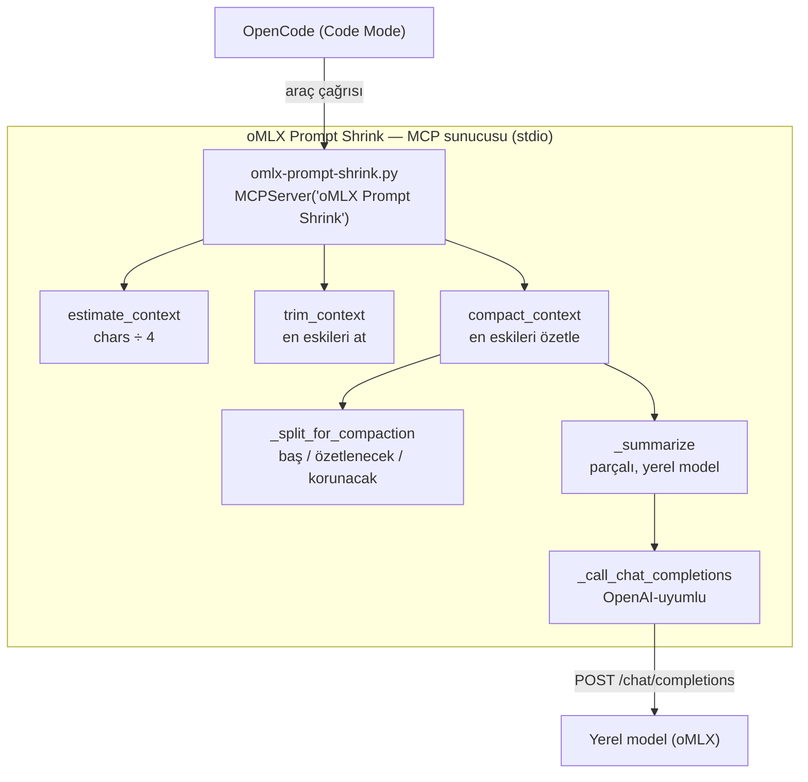

# oMLX Prompt Shrink


🌐 [English](./README.md) · **Türkçe**

**oMLX Prompt Shrink**, **oMLX / yerel Qwen** isteklerini modelin bağlam (context) sınırının altında tutan küçük bir MCP sunucusudur. Çağrıdan önce bağlamı ölçer, ardından en eski mesajları ya **atar** ya da bir özete **sıkıştırır** — böylece sunucunun isteği reddetmesinin önüne geçer.

> **Token sayımı:** kuruluysa yakın bir tahmin için `tiktoken` kullanır (varsayılan `cl100k_base`), aksi hâlde tokenizer'sız bir tahmine (karakter sayısı ÷ 4) düşer. Her iki durumda da bu bir güvenlik bariyeridir, kesin bir bütçe değildir — davranışı değiştirmek için `OMLX_SHRINK_TOKENIZER` ayarlanır.

---

## 📖 Genel Bakış

Bu sınıftaki modeller için oMLX profilleri **32K bağlam** (`max_context_window: 32768`) ile çalışır. Bu bilinçli bir tercihtir: 4-bit KV önbelleğiyle çalışma zamanı ayak izini model başına yaklaşık 17–20 GB'ta tutar ve Apple Silicon'da prefill'i kısa tutar. Sınırı yükseltmek bedavadır değildir — bağlamdaki her ek token, bellekte ve prefill süresinde ödenir.

Maliyet uzun bir oturumda ortaya çıkar. Sistem promptu, konuşma geçmişi ve araç sonuçları birikir; toplam tavanı aştığında sunucu tüm isteği reddeder:

```text
Prompt is too long: 39514 tokens > 32768 maximum context length
```

Bu noktada ajan durur. Soruda yanlış bir şey yoktu — prompt yalnızca 6.7K token fazlaydı. Alışılmış çözüm yollarının hiçbiri tatmin edici değildir:

| Çözüm yolu | Neden yetersiz |
| :--- | :--- |
| `max_context_window` değerini yükseltmek | Duvarı kaydırır, kaldırmaz; aynı makinede bellek ve prefill hızına mal olur |
| Elle kırpmak | Manuel, unutması kolay, koca oturumları çöpe atar |
| Yeni bir oturum başlatmak | Görevi çalıştıran bağlamı kaybeder |

Bu yüzden sunucu ucuz yolu seçer: **32K'yı koru, daha küçük bir prompt gönder.**

Tam anlatımı okuyun (neden 32K, üç sıkıştırma modu, ortam değişkenleri ve bilinen sınırlamalar):

**[English →](./README.md)** · **[Türkçe →](./README.tr.md)**

---

## ✅ Öneri

Sabit bir bağlam penceresine sahip oMLX veya başka bir yerel OpenAI-uyumlu sunucu kullanıyorsanız ve en az bir kez `Prompt is too long` hatası aldıysanız kullanın. Tek bir Python dosyasıdır ve GPU gerektirmez. `estimate_context` ve `trim_context` saf aritmetiktir — çıkarım zamanında hiçbir maliyeti yoktur. `compact_context` yalnızca özetlemesini istediğinizde yerel modeli çağırır (ya da hazır bir özet verirsiniz ve hiçbir şey çağırmaz).

Bağlam pencereniz oturumlarınız için yeterince büyükse ya da istemciniz geçmişi kendi başına sıkıştırıyorsa muhtemelen buna ihtiyacınız yok.

---

## 🛠️ Teknoloji Yığını ve Mimari

- **Dil ve Çalışma Zamanı:** Python 3.10+, yalnızca standart kütüphane
- **Protokol:** Model Context Protocol (MCP), stdio taşıması üzerinden
- **İstemci:** OpenCode (Code Mode araçları `tools.oMLX_Prompt_Shrink.*` altında gruplar)
- **Sıkıştırma Motoru:** Yerel OpenAI-uyumlu endpoint üzerinden parçalı (chunked) özetleme
- **Token Sayımı:** opsiyonel `tiktoken` (varsayılan `cl100k_base`), karakter tabanlı heuristic fallback — zorunlu bağımlılık yok
- **Bağımlılıklar:** `mcp` (MCP SDK) zorunlu; `tiktoken` opsiyonel — GPU gerekmez
- **Hedef Sunucu:** oMLX (veya herhangi bir yerel OpenAI-uyumlu sunucu: llama.cpp, LM Studio, …)
- **Varsayılanlar:** `max_context_tokens = 32768`, `keep_last = 8`, `threshold = 0.8`

---

## ✨ Özellikler

- 🧮 **Yeterince doğru tahmin** — `estimate_context` tahmini token sayısını, kalan bütçeyi ve `should_trim` bayrağını döner
- ✂️ **En eski mesajları at** — `trim_context`, en eski mesajları çıkarılmış mesaj listesini döner; en yeni `keep_last` tanesini korur
- 🧠 **Atmak yerine sıkıştır** — `compact_context`, en eski mesajları bir **özetle** değiştirir; baştaki sistem mesajlarını ve en yeni `keep_last` tanesini aynen korur
- 📝 **Üç sıkıştırma modu** — özet verilmiş, modelle üretilmiş veya yalnızca plan (`needs_summary: true`, mesaj içeriği geri döndürülmez)
- 🌐 **Opsiyonel gerçek tokenizer** — kuruluysa `tiktoken`, aksi hâlde tokenizer'sız tahmin (karakter ÷ 4); seçimi `OMLX_SHRINK_TOKENIZER` belirler
- 🔌 **Sade MCP** — herhangi bir MCP istemcisi sunucuyu kullanabilir, yalnızca OpenCode değil
- 🧩 **Parçalı özetleme** — uzun geçmişler parça parça özetlenir, böylece yerel model özetlerken taşmaz
- 🔒 **Telemetri yok, ağ çağrısı yok** — opsiyonel yerel özetleyici isteği hariç

---

## 📸 Ekran Görüntüleri

_(Arayüz yok — bu başsız (headless) bir MCP sunucusudur. Araç çıktısı stdio üzerinden JSON'dur.)_

---

## 🏗️ Mimari



---

### `compact_context` üç modda

1. **Özet verilmiş** — `summary="..."` geçin, model çağrısı yapılmaz. Ajan (veya
   kullanıcı) özeti zaten yazdıysa bunu kullanın.
2. **Modelle üretilmiş** — `model="..."` (ve isteğe bağlı `base_url`) geçin ya da
   aşağıdaki ortam değişkenlerini ayarlayın; sunucu en eski mesajları sizin için
   özetler. Uzun geçmişler parça parça özetlenir, böylece yerel model özetlerken
   taşmaz.
3. **Yalnızca plan** — ikisi de yoksa çağrı `needs_summary: true`, kullanılacak tam
   `summary_prompt` ve token sayılarını döner. **Hiçbir mesaj içeriği geri
   döndürülmez**, bu yüzden sonuç küçük kalır; `summary=<metin>` ile tekrar
   çağırın. Ortam bir model tanımlasa bile bu adımı zorlamak için `model=""` geçin.

`compact_context` birleştirilmiş `messages` listesini yalnızca 1 ve 2. modlarda
döner ve tahmin `threshold` içindeyse, `force: true` geçmediğiniz sürece listeyi
değiştirmez (`compacted: false`).

> **Model endpoint'i gerekmez:** 1 ve 3. modlar hiçbir `OMLX_SHRINK_*` değişkeni
> olmadan çalışır. Ortam değişkenleri yalnızca 2. modu etkinleştirir.

---

## 🚀 Kurulum ve Hızlı Başlangıç

### 1. Gereksinimler

| Gereksinim | Sürüm / Notlar |
| :--- | :--- |
| **Python** | 3.10+ (`/opt/homebrew/bin/python3` ile test edildi) |
| **MCP SDK** | `pip install mcp` |
| **Tokenizer** *(opsiyonel)* | Gerçek token sayımı için `pip install tiktoken`; aksi hâlde karakter ÷ 4'e düşer |
| **İstemci** | OpenCode (veya herhangi bir MCP istemcisi) |
| **Model sunucusu** | oMLX veya başka bir yerel OpenAI-uyumlu sunucu (opsiyonel, model modu için) |

### 2. SDK'yı kurun

```bash
pip install mcp
```

### 3. Sunucuyu kopyalayın

`omlx-prompt-shrink.py` dosyasını seçtiğiniz bir dizine kopyalayın (örneğin `~/.config/opencode/mcp/`).

> **Not:** `command` dizisindeki `python3` beklediğiniz yorumlayıcı olmayabilir —
> kurulumunuza göre `/opt/homebrew/bin/python3`, `/usr/bin/python3` veya başka bir
> yer olabilir. Yolu `which python3` (veya `which python`) ile doğrulayın ve
> gerekirse düz `python3` yerine mutlak yolu kullanın.

### 4. OpenCode'a kaydedin

Sunucuyu OpenCode yapılandırmanıza (`~/.config/opencode/opencode.jsonc`) ekleyin:

```jsonc
{
  "mcp": {
    "servers": {
      "oMLX Prompt Shrink": {
        "type": "local",
        "command": [
          "python3",
          "/absolute/path/to/omlx-prompt-shrink.py"
        ],
        "timeout": 180000
      }
    }
  }
}
```

Yapılandırma değişiklikleri yeniden başlatma gerektirmez — OpenCode yapılandırma dosyalarını izler ve kayıttan sonra MCP sunucularını yeniden yükler. Tam yeniden yükleme için `/reload` çalıştırın.

### 5. (Opsiyonel) Model modunu etkinleştirin

`compact_context` yerel modelle özetleyebilsin diye ortam değişkenlerini MCP girdisindeki `environment` altında ayarlayın:

```jsonc
"environment": {
  "OMLX_SHRINK_MODEL": "Qwen3.6-35B-A3B-4bit",
  "OMLX_SHRINK_BASE_URL": "http://127.0.0.1:8000/v1",
  "OMLX_SHRINK_API_KEY": "omlx-...",
  "OMLX_SHRINK_TIMEOUT": "180",
  "OMLX_SHRINK_TOKENIZER": "auto"
}
```

### Yapılandırma

`compact_context`, argümanlar verilmediğinde endpoint'ini ve modelini ortamdan okur:

| Değişken | Varsayılan | Anlamı |
| :--- | :--- | :--- |
| `OMLX_SHRINK_BASE_URL` | `http://127.0.0.1:8000/v1` | OpenAI-uyumlu base URL |
| `OMLX_SHRINK_MODEL` | *(boş)* | Özetleme için kullanılacak model adı; boşsa model modu kapalıdır |
| `OMLX_SHRINK_API_KEY` | *(boş)* | Sunucu gerektiriyorsa Bearer token |
| `OMLX_SHRINK_TIMEOUT` | `180` | Özetleyici istek zaman aşımı, saniye |
| `OMLX_SHRINK_TOKENIZER` | `auto` | Token sayacı: `auto` (kuruluysa tiktoken `cl100k_base`, yoksa heuristic), bir tiktoken encoding adı veya her zaman karakter ÷ 4 için `heuristic`/`off` |

### 6. Kullanın

- Geçerli mesaj listesiyle `estimate_context` çağırın.
- `should_trim` `true` ise, `trim_context` çağırıp dönen listeyi gönderin ya da
  atmak yerine özü korumak için `compact_context` kullanın.
- Bir ajan, tahmin sınırı aştığında bunu her istekten önce otomatik yapabilir.

Örnek çağrı:

```json
{
  "messages": [
    { "role": "user", "content": "ilk mesaj" },
    { "role": "assistant", "content": "ilk yanıt" },
    { "role": "user", "content": "ikinci mesaj" }
  ],
  "keep_last": 8,
  "max_context_tokens": 32768
}
```

Sıkıştırma akışı, model modu:

```json
{
  "messages": [ "..." ],
  "keep_last": 8,
  "model": "Qwen3.6-35B-A3B-4bit",
  "base_url": "http://127.0.0.1:8000/v1"
}
```

Sıkıştırma akışı, ajan modu (iki çağrı):

1. `compact_context({ "messages": [...], "force": true })` → `needs_summary: true`
   ve `summary_prompt`.
2. Ajan özeti yazar, ardından tekrar çağırır:
   `{ "messages": [...], "force": true, "summary": "<o metin>" }` → sıkıştırılmış
   `messages` listesi.

---

## 📂 Proje Yapısı

```
omlx-prompt-shrink/
├── omlx-prompt-shrink.py    # Tek dosyalık MCP sunucusu (ürünün tamamı)
├── README.md                # İngilizce dokümantasyon
├── README.tr.md             # Bu dosya (Türkçe)
├── CONTRIBUTING.md          # Kurulum, testler, commit kuralları
├── CHANGELOG.md             # Keep a Changelog sürüm notları
├── requirements-dev.txt     # Geliştirme bağımlılıkları (mcp, pytest, ruff, tiktoken)
├── .ruff.toml               # Ruff lint yapılandırması
├── .github/workflows/ci.yml # CI: lint + derleme + testler
├── tests/                   # pytest birim testleri
│   ├── conftest.py          # Sunucu modülünü yola göre yükler; ortak fixture'lar
│   └── test_omlx_prompt_shrink.py # Saf yardımcılar + tokenizer çözümleme
├── LICENSE                  # MIT
└── .gitignore
```

---

## 🧪 Test ve CI

```bash
pip install -r requirements-dev.txt
ruff check .        # lint
pytest -q           # birim testleri
```

- **Paketler:** `tests/` saf yardımcıları (token tahmini, kırpma, sıkıştırma bölme ve parçalama) ve opsiyonel tokenizer çözümleme mantığını kapsar — ağ yok, MCP taşıması yok.
- **CI:** [`.github/workflows/ci.yml`](./.github/workflows/ci.yml) her push ve pull request'te Ruff, bir `py_compile` kontrolü ve `pytest` çalıştırır.

Sunucuyu elle, bir istemci üzerinden çalıştırmak için:

```bash
python3 omlx-prompt-shrink.py   # stdio sunucusunu başlatır; durdurmak için Ctrl-C
```

---

## 📚 Dokümantasyon

- [README.md](./README.md) — İngilizce sürüm.
- [README.tr.md](./README.tr.md) — bu dosya.
- [omlx-prompt-shrink.py](./omlx-prompt-shrink.py) — araç şemaları ve davranışın kaynağı.
- [CONTRIBUTING.md](./CONTRIBUTING.md) — geliştirme kurulumu, testler ve commit kuralları.
- [CHANGELOG.md](./CHANGELOG.md) — sürüm notları.

---

## 📝 Notlar

- Varsayılan bağlam sınırı: `32768` token — profilinize göre değiştirin.
- Kırpma politikası: önce en eski mesajlar; son `keep_last` mesaj her zaman korunur.
- Sıkıştırma politikası: baştaki `system` mesajları korunur, geri kalanların en eskileri özeti taşıyan tek bir `system` mesajıyla değiştirilir ve son `keep_last` mesaj aynen korunur.
- Araç yüzeyi sade MCP'dir; yani yalnızca OpenCode değil, herhangi bir MCP istemcisi sunucuyu kullanabilir.

---

## 🔗 Arka Plan

Bu sunucunun ele aldığı 32K profili ve `Prompt is too long` hatası [`mahirfatih/omlx-m1-max-benchmark`](https://github.com/mahirfatih/omlx-m1-max-benchmark) deposunda belgelenmiştir: `docs/reference/PROFILES.md` bağlam penceresinin neden 32K olduğunu açıklar, README ise bu sunucu için öneri bölümünü içerir.

---

## 🔐 İzinler ve Gizlilik

| Ayar / Anahtar | Amaç | Konum |
| :--- | :--- | :--- |
| `OMLX_SHRINK_BASE_URL` | OpenAI-uyumlu base URL | ortam / argüman |
| `OMLX_SHRINK_MODEL` | Özetleme için kullanılan model | ortam / argüman |
| `OMLX_SHRINK_API_KEY` | Yerel sunucu için Bearer token | ortam / argüman |
| `OMLX_SHRINK_TIMEOUT` | Özetleyici istek zaman aşımı (saniye) | ortam |
| `OMLX_SHRINK_TOKENIZER` | Token sayacı seçimi (`auto` / encoding / `heuristic`) | ortam |

> **Gizlilik:** Sunucu, yapılandırdığınız yerel OpenAI-uyumlu endpoint'e yapılan opsiyonel özetleyici çağrısı dışında **kendi başına hiçbir ağ isteği yapmaz**. Telemetri yok, analitik yok, hiçbir veri makineden çıkmaz. Tüm durum yalnızca bir araç çağrısı boyunca bellekte tutulur.

**Sürüm:** `1.0.0`

---

## 📄 Lisans

Bu proje MIT Lisansı ile lisanslanmıştır.
